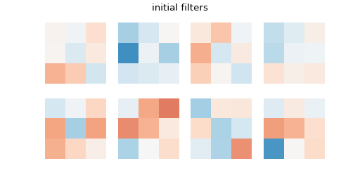
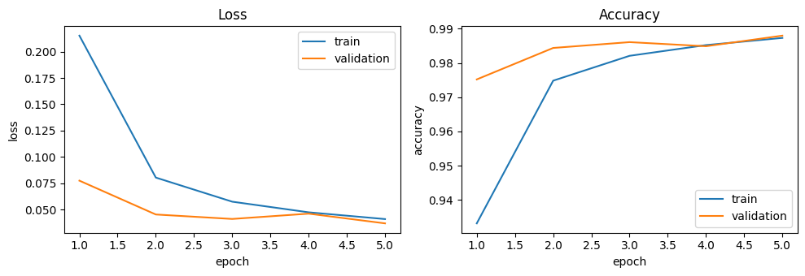
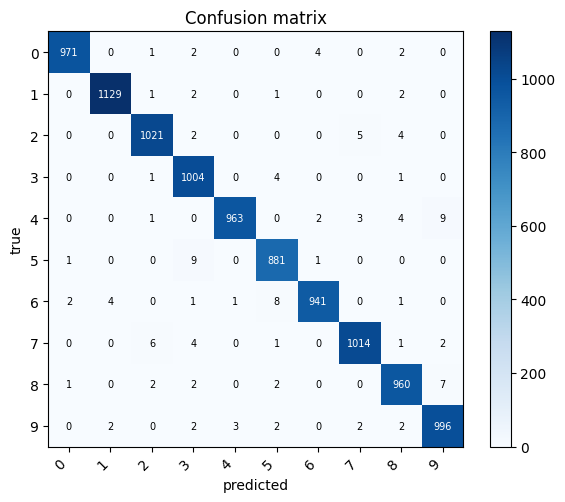
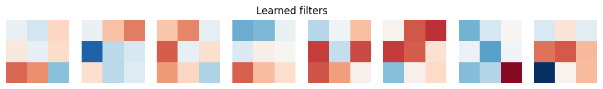
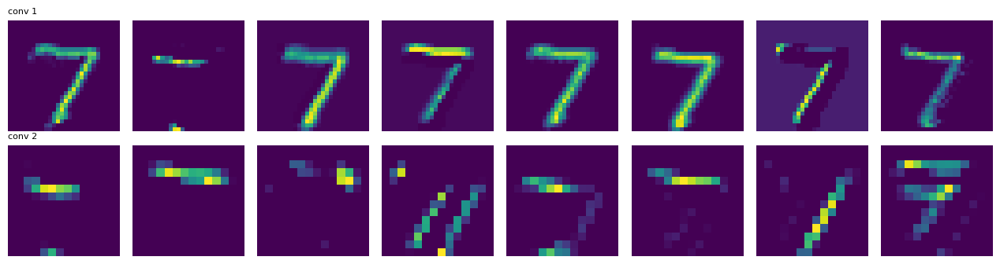
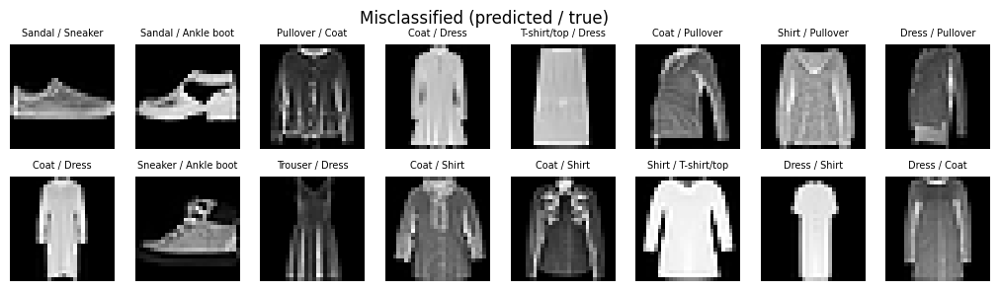
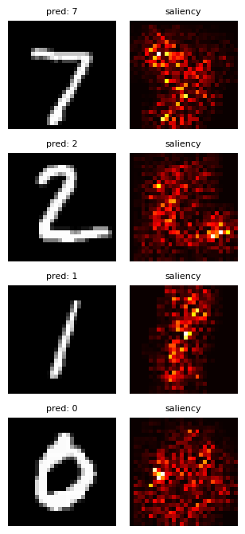

# np.cnn


Small convolutional neural network library from scratch using NumPy: `Conv2d` vectorized with `im2col`, `MaxPool2d`, a tiny layer/loss/optimizer framework and plots to look inside the network. A small CNN reaches **98.8 % on MNIST** and **89.6 % on Fashion-MNIST**, matching PyTorch's accuracy on CPU (though PyTorch is about 4x faster).



## Install

```bash
pip install -e .            # library
pip install -e ".[dev]"     # + pytest and notebook tooling
pip install -e ".[bench]"   # + PyTorch for the benchmark
```

## Usage

```python
from cnn import Sequential, Conv2d, MaxPool2d, Flatten, Linear, ReLU, Dropout, Adam
from cnn.utils import load_mnist

(Xtr, ytr), (Xte, yte) = load_mnist(flatten=False)      # images (N, 1, 28, 28)
model = Sequential([
    Conv2d(1, 8, 3, padding=1), ReLU(), MaxPool2d(2),
    Conv2d(8, 16, 3, padding=1), ReLU(), MaxPool2d(2),
    Flatten(), Linear(16 * 7 * 7, 128), ReLU(), Dropout(0.25), Linear(128, 10),
])
history = model.fit(Xtr, ytr, epochs=5, batch_size=64, optimizer=Adam(lr=1e-3), validation_data=(Xte, yte))
loss, acc = model.evaluate(Xte, yte)
```

The equivalent in PyTorch:

```python
import torch.nn as nn
model = nn.Sequential(
    nn.Conv2d(1, 8, 3, padding=1), nn.ReLU(), nn.MaxPool2d(2),
    nn.Conv2d(8, 16, 3, padding=1), nn.ReLU(), nn.MaxPool2d(2),
    nn.Flatten(), nn.Linear(16 * 7 * 7, 128), nn.ReLU(), nn.Dropout(0.25), nn.Linear(128, 10),
)
# + optimizer, DataLoader and the training loop written by hand
```

### Old API (still supported)

```python
from cnn.model import FCLayer, Flatten, ConvLayer, CNN

cnn = CNN(layers=[
    ConvLayer(k_dim=3, padding=1, stride=1),     # Conv2d(1, 1, 3) + ReLU
    ConvLayer(k_dim=3, padding=1, stride=1),
    Flatten(),
    FCLayer(n_input=64, n_output=128, activation='relu'),
    FCLayer(n_input=128, n_output=10, activation='softmax'),
])
cnn.train(X, Y, epochs=25, lr=0.001)             # X: (N, 1, 8, 8), Y: (N, 10, 1), SGD with batch_size=1
cnn.test(Xtest, Ytest)
```

`NN(layers=[...])` for plain MLPs is available too. `train` and `test` still print and now also return the history / the accuracy; they accept `batch_size`, `optimizer`, `validation_data` and `verbose`. `ConvLayer` takes optional `in_channels` and `out_channels` (default 1 and 1, as in the original).

> The original architecture, a single-channel convolution followed by ReLU with zero-initialised bias, can start "dead" with an unlucky seed and never learn (loss stuck at ln 10). If that happens, change the seed or use more channels.

## Package layout

| Module | Contents |
|---|---|
| `cnn/layers.py` | `Layer` base class, `Linear`, activations, `Dropout` and, specific to np.cnn, `Conv2d`, `MaxPool2d`, `Flatten` |
| `cnn/losses.py` | `CrossEntropy` (softmax included, numerically stable) and `MSE` |
| `cnn/optim.py` | `SGD` (momentum, weight decay) and `Adam` |
| `cnn/model.py` | `Sequential` (`fit`, `predict`, `evaluate`, `save`, `load`) and the old-API facades `NN`, `FCLayer`, `ConvLayer`, `CNN` |
| `cnn/utils.py` | `one_hot`, `train_test_split`, loaders for digits, MNIST and Fashion-MNIST |
| `cnn/viz.py` | curves, confusion matrix, learned filters, feature maps, misclassified examples, saliency maps |
| `cnn/reference.py` | convolution with Python loops, used as a reference in tests and the benchmark |

Images are `(N, C, H, W)` and convolution weights `(out_channels, in_channels, k, k)`. Every layer exposes `forward`, `backward`, `params()` and `grads()`, so a generic optimizer updates any model. The modules `layers`, `losses`, `optim`, `model`, `utils` and `viz` share their base code with [np.nn](https://github.com/sanahuel/np.nn); np.cnn only adds the sections marked "Solo np.cnn" at the end of `layers.py`, `model.py` and `viz.py`.

## Results

| Dataset | Model | Test accuracy |
|---|---|---|
| Digits 8x8 | Conv(1→8)-ReLU-Pool-Linear, 30 epochs | 97.77 % |
| MNIST | 2 conv + pool blocks, dropout 0.25, 5 epochs | 98.80 % |
| Fashion-MNIST | same model, 5 epochs | 89.58 % |




### Looking inside the network

| Learned filters | Feature maps of a digit |
|---|---|
|  |  |

| Misclassified examples (Fashion-MNIST) | Saliency maps (MNIST) |
|---|---|
|  |  |

The full walkthrough is in [`demo.ipynb`](demo.ipynb).

## Benchmark

CPU only (Intel64 Family 6 Model 165, 6 PyTorch threads, NumPy 2.2.6, PyTorch 2.14.1), float32.

**Loops vs im2col** (forward + backward, best of 5). The loop version is already vectorized over batch and channels, so the gap against the original per-sample loops would be much larger:

| Config | loops (ms) | im2col (ms) | speedup |
|---|---|---|---|
| N=32, 1->8, 28x28, k=3, p=1 | 51.2 | 5.1 | 10.1x |
| N=32, 8->16, 14x14, k=3, p=1 | 19.8 | 5.8 | 3.4x |
| N=32, 16->32, 7x7, k=3, p=1 | 8.2 | 3.8 | 2.2x |

**np.cnn vs PyTorch** (same CNN as above, Adam lr 1e-3, batch size 64, 5 epochs):

| Dataset | Framework | s / epoch | Test accuracy |
|---|---|---|---|
| mnist | np.cnn | 35.8 | 98.80% |
| mnist | PyTorch | 9.2 | 98.66% |
| fashion | np.cnn | 35.8 | 89.58% |
| fashion | PyTorch | 10.5 | 89.32% |

Regenerate with `python benchmarks/benchmark.py [--only conv|mnist|fashion] [--quick]` (needs `.[bench]`); results go to `results/`.

## How im2col works

Each k×k window of the input (with all its channels) is flattened into one row of a matrix `cols`:

```
input 1×4×4, kernel 2×2, stride 2         cols (4 windows × 4 values)
 0  1  2  3                                [ 0  1  4  5 ]
 4  5  6  7                                [ 2  3  6  7 ]
 8  9 10 11                                [ 8  9 12 13 ]
12 13 14 15                                [10 11 14 15 ]

and the convolution becomes one matrix product:

    Y = cols · W_rᵀ + b        (W_r: flattened filters, F × C·k²)
```

So the heavy work is done by BLAS instead of Python loops. `col2im` does the inverse operation in the backward pass, **adding** the contributions of overlapping windows.

## Backpropagation

**Convolution.** Forward, with $X^{p}$ the padded input and stride $s$:

$$Y_{n,f,i,j} = b_f + \sum_{c,u,v} W_{f,c,u,v}\; X^{p}_{n,c,\,si+u,\,sj+v}$$

With $G = \partial L / \partial Y$:

$$\frac{\partial L}{\partial b_f} = \sum_{n,i,j} G_{n,f,i,j}
\qquad
\frac{\partial L}{\partial W_{f,c,u,v}} = \sum_{n,i,j} G_{n,f,i,j}\, X^{p}_{n,c,\,si+u,\,sj+v}$$

$$\frac{\partial L}{\partial X^{p}_{n,c,h,w}} = \sum_{f}\sum_{\substack{i,j,u,v\\ si+u=h,\ sj+v=w}} G_{n,f,i,j}\, W_{f,c,u,v}$$

With stride 1 this is a "full" convolution of $G$ with the kernel rotated 180°. Finally the padding is removed: $\partial L/\partial X = \partial L/\partial X^{p}[\,:, :, p{:}H{+}p,\ p{:}W{+}p\,]$ (the original code cropped the top-left corner instead, which was a bug).

In matrix form (im2col), with $G_r \in \mathbb{R}^{(N\,H_o W_o)\times F}$:

$$\nabla W_r = G_r^\top\, \mathrm{cols},\qquad \nabla b = \textstyle\sum_{\text{rows}} G_r,\qquad \nabla \mathrm{cols} = G_r\, W_r,\qquad \nabla X = \mathrm{col2im}(\nabla \mathrm{cols})$$

**Max pooling.** The gradient of each window goes entirely to the position of the maximum; the rest receive 0.

**Linear layer.** With $Y = XW + b$, $X \in \mathbb{R}^{N\times d}$ and $G = \partial L/\partial Y$:

$$\frac{\partial L}{\partial W} = X^\top G,\qquad \frac{\partial L}{\partial b} = \sum_{n} G_{n,:},\qquad \frac{\partial L}{\partial X} = G\,W^\top$$

**Softmax + cross-entropy.** With $p = \mathrm{softmax}(z)$ and $L = -\frac{1}{N}\sum_n \sum_k y_{nk}\log p_{nk}$:

$$\frac{\partial p_i}{\partial z_j} = p_i(\delta_{ij} - p_j) \;\Rightarrow\; \frac{\partial L}{\partial z} = \frac{1}{N}(p - y)$$

That is why the softmax lives inside the loss: the Jacobian collapses and the gradient is stable. The original code multiplied $(p - y)$ again by $p(1-p)$, which was a bug (and the reason it needed `lr=1e-4`).

**Numerical stability.** $\log\mathrm{softmax}(z) = z - \max(z) - \log\sum_j e^{z_j - \max(z)}$.

## Tests

```bash
pytest            # fast tests
pytest -m slow    # also downloads MNIST
```

Layers, losses and whole models are checked against central finite differences in float64 (relative error < 1e-5), including `Conv2d` with several stride and padding combinations and `MaxPool2d`. `im2col` is compared against the loop convolution (error ~1e-12), small batches can be overfit, save/load round-trips, and the old API keeps working with the old shapes.

## License

MIT
